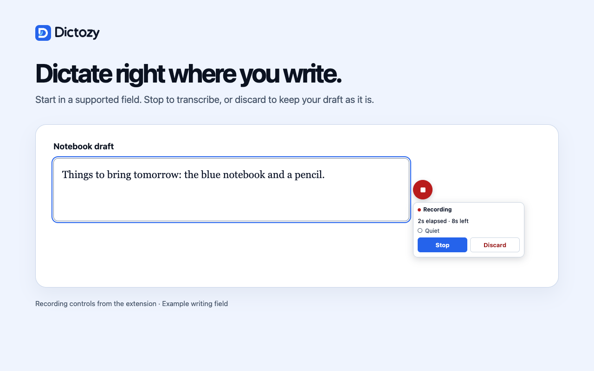
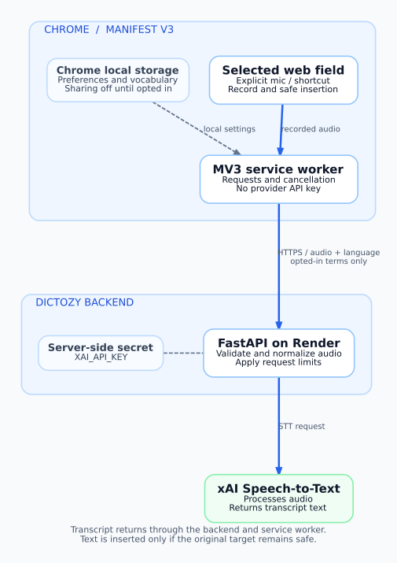
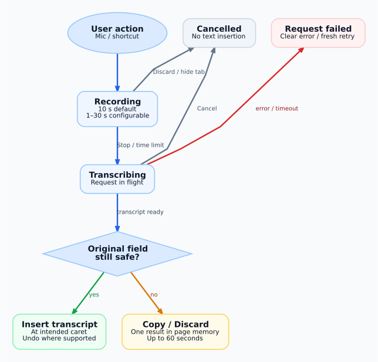

<p align="center">
  
</p>

<h1 align="center">Voice dictation for Chrome</h1>

<p align="center">
  Speak a short message, note, search, or form entry directly into a supported Chrome field.
  Start recording yourself, then keep editing where you left off.
</p>

<p align="center">
  <a href="https://chromewebstore.google.com/detail/dictozy-voice-dictation/folpeencabfejhjokmldikaelonphmma">Chrome Web Store</a> ·
  <a href="https://dictozy.com/">Website</a> ·
  <a href="site/guide.html">Interactive guide source</a> ·
  <a href="https://dictozy.com/privacy.html">Privacy policy</a> ·
  <a href="mailto:dictozy.support@gmail.com">Email support</a>
</p>



*Actual 0.1.14 candidate UI, captured with synthetic audio. This image is **not** a claim that 0.1.14 is already publicly available.*

## Release status

**Snapshot — November 2, 2026.** Repository source, Chrome Web Store publication, and website deployment are separate milestones.

| Surface | Verified state |
| --- | --- |
| Chrome Web Store | **0.1.13 public.** Version 0.1.14 was submitted for review; automatic publication is **off**, so approval alone will not publish it. |
| `main` extension | **0.1.14**: refreshed blue icon, popup, practice page, recording and recovery UI, with existing dictation behaviour preserved. |
| `main` website | Modernized blue design and a six-step interactive guide are merged but **not yet deployed**. Its 0.1.14 version metadata is staged only in source. |
| Public website | The prior live site remains on 0.1.13 until the matching Store release is verified and GitHub Pages is manually deployed. |
| Backend | Existing approved FastAPI deployment remains live. Render auto-deploy is **off**; the 0.1.14 update does not require a backend release. |

See the [0.1.14 candidate record](store/release-0.1.14.md), [0.1.13 published release record](store/release-0.1.13.md), and [website review](docs/WEBSITE_REVIEW.md) for dated evidence. Check the Store listing for the latest public version rather than treating this snapshot as a live status indicator.

## What Dictozy does

- **Record on purpose.** Click the microphone beside a supported field or use your assigned Chrome shortcut. Stop to transcribe or Discard to cancel. Recording defaults to 10 seconds, configurable from 1 to 30 seconds.
- **Keep your place.** The returned plain-text transcript is inserted only when the intended field and selection are still safe. Standard Undo works in supported editors; compatibility with complex editors varies.
- **Recover a result safely.** If a completed transcript cannot be inserted, one result may be offered for **Copy / Discard** in page memory for up to 60 seconds. Cancelled dictation is not recoverable, and Dictozy does not keep a permanent transcript history.
- **Adjust to your workflow.** The popup includes language formatting (Automatic plus 25 explicit choices), a global toggle, per-site control, recording limit, shortcut management, and an optional practice page.
- **Keep vocabulary under your control.** Save up to 100 terms (50 characters each) locally. A **separate, off-by-default** choice is required to send them as transcription hints. Hints do not guarantee improved recognition.

Dictozy supports ordinary text, search, email, URL and telephone inputs; textareas; and supported contenteditable/ARIA-editable textboxes. It skips password, payment, hidden, disabled, and read-only fields. Selected Gmail and ChatGPT workflows have been checked; Notion, Outlook and WhatsApp Web compatibility remains unverified. The public website's [support page](https://dictozy.com/support.html) covers common troubleshooting.

## How it works

Dictozy is a **Manifest V3 Chrome extension** built with plain JavaScript. Its content script interacts with the selected field; its background service worker sends a bounded, user-initiated audio request to the fixed Dictozy FastAPI backend on Render. The backend validates and normalizes audio, calls xAI Speech-to-Text, and returns text through the extension. **The extension never talks directly to xAI and never contains `XAI_API_KEY`.**



*Blue arrows show request flow. The transcript returns via FastAPI and the service worker; it reaches the page only when insertion is safe. [Editable diagram source](docs/diagrams/architecture.dot).*

### Recording and safe insertion



*Discarding or hiding the tab cancels active recording; cancelling a pending request prevents late text insertion. Recovery is available only for eligible **completed** results, not cancelled requests. [Editable diagram source](docs/diagrams/recording-lifecycle.dot).*

### Data boundary

- Audio is sent from the extension to Dictozy's backend, then to xAI for transcription. The chosen language is included; vocabulary terms accompany a request **only when sharing has been explicitly enabled**.
- Global/site settings and saved vocabulary live in `chrome.storage.local`. The extension does **not** send the page URL, existing field contents, or surrounding page text as part of the dictation request.
- The backend enforces upload and resource limits, but its in-process controls are **not a durable billing cap**. The health endpoint checks service liveness, not provider or billing readiness.
- The [privacy policy](PRIVACY.md) describes technical metadata, provider processing, temporary audio-upload spooling and retention boundaries. Do not treat “no account required” as “offline transcription.”

## Run locally

Requirements: Chrome/Chromium, Node.js, Python, and development dependencies defined by this repository.

```bash
git clone https://github.com/fredjkhar/dictozy-voice-dictation-extension.git
cd dictozy-voice-dictation-extension
npm ci
npx playwright install chromium
```

**Load the unpacked extension:** open `chrome://extensions`, enable **Developer mode**, choose **Load unpacked**, and select the repository's `extension/` directory. Reload a normal HTTPS test page after loading the extension.

> **Important:** The unpacked extension in `main` still targets the fixed **production** Dictozy backend. Running FastAPI locally does not redirect it. An ordinary recording can reach xAI and consume paid credits. For provider-free verification, use the repository's mocked/synthetic Chromium workflows below; do not use a real microphone for routine testing.

**Preview the website and six-step guide** without installing the extension or making transcription requests:

```bash
python3 -m http.server 8080 --bind 127.0.0.1 --directory site
```

Open `http://127.0.0.1:8080/` and `http://127.0.0.1:8080/guide.html`. The guide's recording and vocabulary interactions are **simulations**; no microphone access or audio upload occurs.

**Run the backend locally** for backend development (this alone does not change the extension's endpoint):

```bash
cd backend
python3 -m venv .venv
source .venv/bin/activate
pip install -r requirements-dev.txt
cp .env.example .env
# Put your own XAI_API_KEY in backend/.env only if an authorized provider call is needed.
uvicorn app.main:app --reload --no-access-log
```

`GET http://127.0.0.1:8000/health` returns a liveness result. Keep `backend/.env` and any secrets out of Git.

## Tests and packaging

From the repository root, after `npm ci` and the Playwright browser install:

```bash
node --test extension/tests/*.test.js     # extension unit tests
npm run test:browser                      # MV3/Chromium workflows, stubbed provider
npm run test:site                         # website and interactive guide
python3 scripts/validate_site.py         # site links, policy and SEO invariants
python3 scripts/validate_store_assets.py # Store image checks
python3 scripts/package_extension.py --check-only
```

Backend tests (with the Python environment above):

```bash
cd backend
python -m pytest -q
```

The browser suites use isolated fixtures and synthetic audio; they are **not** a live-provider, physical-microphone or universal editor-compatibility certification. Build a Store ZIP only when preparing an explicitly authorized extension release:

```bash
python3 scripts/package_extension.py
```

The generated `dist/` output is ignored by Git. The published package and version provenance must remain distinct from later documentation/website commits.

## Project map

| Path | Purpose |
| --- | --- |
| [`extension/`](extension/) | MV3 content script, service worker, popup, practice, state management and icons |
| [`backend/`](backend/) | FastAPI route, audio validation/normalization, xAI service and tests |
| [`site/`](site/) | Static website, support/privacy pages and the six-step guide; manual Pages deployment |
| [`store/`](store/) | Release notes, package/capture provenance, Store icons and screenshots |
| [`docs/`](docs/) | Architecture diagrams, compatibility evidence and implementation reports |
| [`qa/`](qa/) | Browser fixtures, test procedures, smoke checks and support triage |
| [`scripts/`](scripts/) | Site/Store validators, package build and asset utilities |

### Documentation and support

- [Interactive guide (repository version)](site/guide.html) · [Website deployment procedure](docs/site-deployment.md)
- [Backend deployment and environment safeguards](backend/DEPLOYMENT.md) · [Compatibility matrix](docs/COMPATIBILITY_MATRIX.md)
- [Release evidence](store/release-0.1.14.md) · [Improvement roadmap](docs/IMPROVEMENT_ROADMAP.md)
- [Privacy policy](PRIVACY.md) · [Support triage](qa/support-triage.md) · **dictozy.support@gmail.com**

## Diagram maintenance

The two diagrams above were authored with **Graphviz** as editable DOT sources in [`docs/diagrams/`](docs/diagrams/) and rendered as scalable SVG, using Dictozy's blue design system. To regenerate after changing their architecture or flow:

```bash
dot -Tsvg docs/diagrams/architecture.dot -o docs/images/extension-flow.svg
dot -Tsvg docs/diagrams/recording-lifecycle.dot -o docs/images/recording-lifecycle.svg
```

Keep the alt text and documentation in step with any diagram changes. Graphviz is a documentation tool, not an extension or website runtime dependency.

